# ravikant

self-taught solo dev. rust, typescript, react. arch linux, niri, terminal first.
i write code from a village in india where the nearest tech meetup is the internet.

  

nobody is playing this. a tiny ai plays a fresh game every day, no clicks needed.

## what i use

rust, axum, surrealdb, typescript, react, astro, cloudflare workers, linux, fish, git.

## say hi

[website](https://ravikan6.tech) · [linkedin](https://linkedin.com/in/ravikan6) · [instagram](https://instagram.com/ravikan_6)

if you are learning without a local community, you are not the only one.
